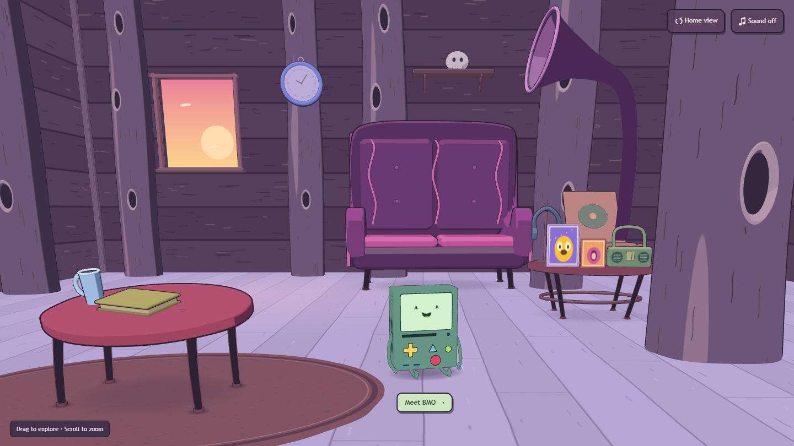
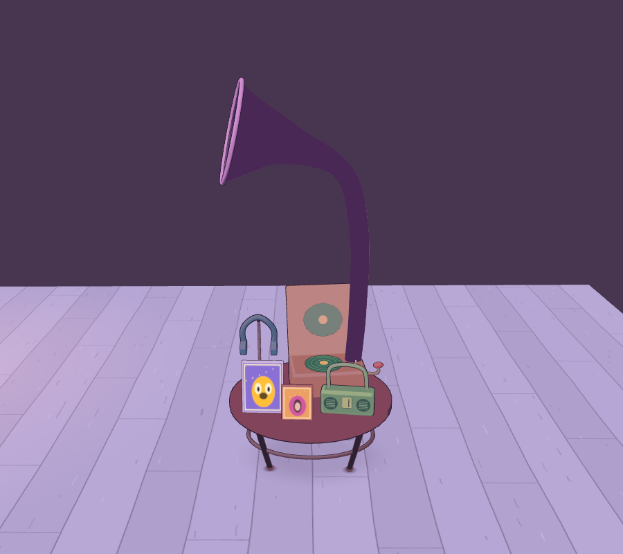
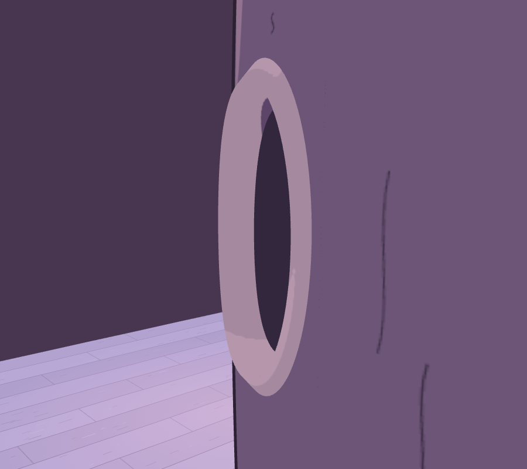
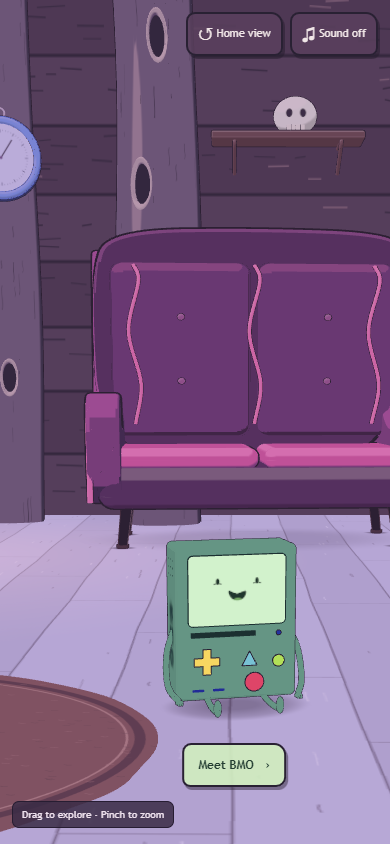

# BMO Portfolio

An interactive 3D portfolio set inside a cartoon treehouse. Meet BMO, explore the room, and use the character’s controls to browse Emre Dönmez’s projects, background, résumé, and contact information.

**[Explore the live portfolio →](https://emreedonmez.com)**



## Overview

The room and BMO share a real Three.js scene. Furniture, tree trunks, recessed cavities, windows, and small props are modelled individually. Painted surface textures and cel shading preserve the illustrated appearance while the camera moves through the scene.

The portfolio interface is rendered on BMO’s display with CSS3DRenderer, keeping readable HTML content aligned with the 3D model. All runtime assets are bundled locally; the application does not require an external model service or asset CDN.

### Features

- Full horizontal room rotation with mouse and touch controls.
- Animated camera approach to BMO and return to the previously explored angle.
- Interactive physical buttons, keyboard navigation, and directly clickable screen menus.
- Responsive layouts for portrait phones, landscape phones, tablets, and desktops.
- Optional retro sound effects and support for reduced-motion preferences.
- A readable HTML portfolio fallback when WebGL is unavailable.
- A static production build that can be hosted with any compatible static web server.

## Screenshots

| Gramophone and room props | Recessed tree detail |
| --- | --- |
|  |  |

<details>
<summary>Mobile room view</summary>



</details>

Screenshots show the project itself. Detail captures isolate selected objects for inspection.

## Getting started

### Requirements

- Node.js 22 or newer.
- npm, included with Node.js.
- A modern browser with WebGL 2 support for the full 3D experience.

### Run locally

```sh
git clone https://github.com/emreedonmez/BMO-portfolio.git
cd BMO-portfolio
npm ci
npm run dev
```

Open the local URL printed by Vite, normally `http://127.0.0.1:5173`.

On Windows, `START_WINDOWS.cmd` also installs dependencies when necessary and starts the development server. Serve the project over HTTP; opening `index.html` directly from the filesystem will not load JavaScript modules correctly.

No hosting account, Cloudflare configuration, Wrangler installation, or API keys are required.

### Preview the production build

```sh
npm run build
npm run preview
```

Vite writes the production output to `dist/`. To publish elsewhere, upload the **contents of `dist/`** to the web root of a static host, or configure a hosting service to run `npm ci && npm run build` and publish `dist`.

The project currently uses root-relative asset URLs. Serve it at a domain root or configure Vite’s base path and the application’s asset URLs before deploying under a subdirectory.

## Controls

| Context | Input | Action |
| --- | --- | --- |
| Room | Hold and drag / one-finger drag | Orbit the camera |
| Room | Mouse wheel / two-finger pinch | Zoom |
| Room | Arrow keys | Adjust the viewing angle |
| Room | Home / **Home view** | Restore the opening view |
| Room | Click BMO / **Meet BMO** | Open the portfolio |
| Portfolio | Yellow directional pad / arrow keys | Browse sections or scroll content |
| Portfolio | Red button / Enter | Select |
| Portfolio | Green button / Escape | Go back |
| Portfolio | Blue triangle / **Room** | Return to the room |
| Either view | Small blue button / **Sound** | Toggle audio |

Screen menus also support direct mouse and touch input. Mobile layouts provide additional navigation buttons. Audio starts muted and can be enabled with the Sound control.

## Project structure

```text
src/
  main.js            Scene setup, camera, input, audio, and screen integration
  scene.js           BMO geometry, materials, face, and physical controls
  bmo-layout.js      Shared model dimensions and button layout
  room.js            Room assembly, furniture, shadows, and camera collisions
  room-geometry.js   Hollow tree geometry and room boundaries
  room-surfaces.js   Procedurally painted surface textures
  navigation.js      Camera transitions and responsive close-up views
  content.js         Portfolio sections, copy, and external links
  portfolio.js       Screen rendering and navigation state
  style.css          Screen interface and responsive styling
public/              Runtime font, résumé, favicon, and dependency notices
docs/images/         Project screenshots used in this README
references/          Design reference; excluded from the production build
scripts/             Browser checks and geometry inspection fixtures
tests/               Unit and configuration tests
```

To adapt the portfolio, start with `src/content.js` and replace `public/ozgecmis.pdf` with your own résumé. Review the page title, metadata, and profile links before publishing your own copy. Rendering and interaction code can remain separate from content changes.

## Development checks

```sh
npm run check
npm test
npm run build
```

The repository also includes browser-based checks for navigation, physical controls, room coverage, touch gestures, camera stability, and detailed object views. With the development server running, execute:

```sh
node scripts/render-check.mjs
node scripts/model-check.mjs
node scripts/room-check.mjs
node scripts/orbit-check.mjs
node scripts/detail-check.mjs
```

These scripts use Playwright with an isolated browser profile. They currently point to Brave’s standard Windows executable path; update `executablePath` in the scripts to use your installed Chromium-compatible browser. Generated screenshots and measurements are written to the ignored `artifacts/` directory.

Touch and viewport checks use browser emulation. They do not replace testing on physical phones or measuring hardware frame rate.

## Technology

[Three.js](https://threejs.org/) handles the 3D scene and CSS3D display. [Vite](https://vite.dev/) provides local development and production bundling. The application is written in JavaScript, HTML, and CSS; [Playwright](https://playwright.dev/) supports browser checks.

## Attribution and reuse

BMO is a character from *Adventure Time*. This is a personal portfolio project and is not affiliated with or endorsed by Cartoon Network or the character’s rights holders. Character and reference artwork rights remain with their respective owners.

Third-party notices for Three.js and the bundled font are retained in `public/`.
